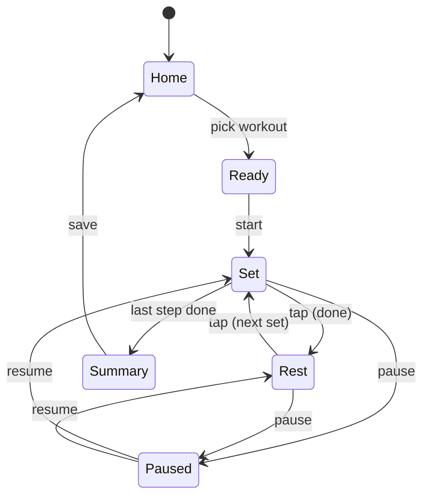

# Workout Runner PWA — Design Doc

Nov 18, 2026

A self-paced workout runner: it shows the next exercise and rep target, you tap when done, and it records how long everything took. No fixed intervals.

## Goals and non-goals

**Goals**

- Run the workouts from [Home Workout System](https://claude.ai/artifact/QNuQPptLjGUCbngMkRDA5P) (A, B, posture/tendon block) from config files.
- One-tap advance: you decide when a set and a rest end.
- Zero screen-looking mid-set: voice announces the next exercise and rep target.
- Log every session (total time, time per round and per set) to track progress.
- Works offline on iPhone as a home-screen app.

**Non-goals (v1)**

- No accounts, backend or sync.
- No HealthKit or Apple Watch data (not available to PWAs).
- No automatic rep counting.
- No in-app workout editor; edit JSON in the repo.

## Session flow



The runner alternates Set and Rest until the last step, and only a tap moves it forward. Pause works from Set or Rest; a long-press undoes the last tap and steps back one state.

## Screens and controls

Six screens. The two that matter mid-workout (Set and Rest) are a single full-screen tap target.

| Screen | Shows | Primary action |
| --- | --- | --- |
| Home | Workout list (A, B, Posture), last completion time for each | Tap a workout |
| Ready | Warm-up list, total rounds, estimated duration from history | Start |
| Set | Exercise name (huge), rep target, round x / y, count-up set timer, small "next up" line | Tap anywhere = done |
| Rest | Count-up rest clock, next exercise + reps, round progress bar | Tap anywhere = start next set |
| Summary | Total time, per-round splits, delta vs last session, optional RPE 1–10 | Save |
| History | Sessions by workout, total time trend | Open a session |

**Controls**

- Tap anywhere on Set/Rest to advance; Space or Enter on desktop.
- Long-press (600 ms) = undo last advance, to fix accidental taps.
- Pause button in a corner; pausing stops all clocks.
- Optional AirPods advance via the Media Session API ("next track"); needs a silent audio loop playing, so treat as experimental.

**Voice cues** (Web Speech API): on entering Set, say "Goblet squats, ten"; on entering Rest, say "Rest. Next: push-ups, ten". Mute toggle on Ready.

## Data model

Workouts are static JSON shipped with the app; sessions are append-only event logs in IndexedDB. Durations are derived from events, never stored twice.

**Block types** cover every structure in the plan:

| Type | Meaning | Example |
| --- | --- | --- |
| `rounds` | Repeat a list of exercises N times | Workout A, 6 rounds |
| `ladder` | Same exercises with reps stepping from `from` to `to` | B part 1, 10 → 1 |
| `total` | Hit a rep total in any set size; each set tap logs reps via quick buttons (10/15/20/25) | 100 swings finisher |
| `hold` | Timed isometric with a countdown (the only countdown in the app) | Wall sit 45 s |

**Workout config** (`/workouts/a.json`)

```json
{
  "id": "workout-a",
  "name": "Workout A — Swing rounds",
  "blocks": [
    { "type": "rounds", "rounds": 6, "exercises": [
      { "name": "KB swings", "reps": 15 },
      { "name": "Goblet squats", "reps": 10 },
      { "name": "Push-ups on handles", "reps": 10 },
      { "name": "KB strict press", "reps": 5, "perSide": true },
      { "name": "Step-back burpees", "reps": 8 }
    ]},
    { "type": "total", "exercise": "KB swings", "target": 50 }
  ]
}
```

**Session log** (IndexedDB store `sessions`)

```json
{
  "id": "uuid",
  "workoutId": "workout-a",
  "workoutVersion": "hash of config",
  "startedAt": "2026-11-18T07:00:00Z",
  "events": [
    { "t": 0, "type": "set_start", "block": 0, "round": 1, "exercise": 0 },
    { "t": 41200, "type": "set_done", "reps": 15 },
    { "t": 93800, "type": "rest_done" },
    { "t": 120000, "type": "pause" },
    { "t": 150000, "type": "resume" },
    { "t": 151000, "type": "undo" }
  ],
  "completedAt": "2026-11-18T07:36:10Z",
  "rpe": 8
}
```

`t` is milliseconds since `startedAt`, from `performance.now()`. Persist after every event so a crash or reload resumes the session.

## Architecture and stack

A static, client-only app: a pure TypeScript state machine at the core, a thin UI on top, IndexedDB for logs, a service worker for offline.

| Layer | Choice | Why |
| --- | --- | --- |
| Framework | SvelteKit with `adapter-static`, TypeScript | Small bundle, simple reactivity; Next.js static export works too |
| PWA | `@vite-pwa/sveltekit` (Workbox) | Manifest, precache, offline in a few lines |
| Core engine | Pure TS reducer: `(state, event) => state` | Unit-testable without a browser; same events feed the log |
| Storage | IndexedDB via `idb` | Async, survives reloads; JSON export/import for backup |
| Tests | Vitest for the engine, Playwright for one happy-path run | Engine is where bugs hide |
| Hosting | Any static host (Cloudflare Pages, Vercel, GitHub Pages) or self-hosted | No backend |

**Engine design**

- `compile(workoutConfig) → Step[]`: flattens rounds, ladders and per-side exercises into a linear list of steps. The runner just walks the list.
- `reduce(state, event)` handles `start`, `done`, `rest_done`, `pause`, `resume`, `undo`, `log_reps`.
- Derived stats (`totalTime`, `roundSplits`, `deltaVsLast`) are pure functions over the event log.

**Browser APIs and iOS caveats**

- **Screen Wake Lock** keeps the phone awake mid-set. Verify it works in home-screen mode on your iOS version; fallback is a muted looping video.
- **Speech synthesis** on iOS only speaks after a user gesture, so warm it up with a silent utterance on the Start tap.
- **Storage:** call `navigator.storage.persist()` and offer JSON export, since Safari can clear site data.
- **Audio cues:** short beeps via Web Audio, also unlocked on the Start tap.
- **Install:** iOS has no install prompt; show a one-time "Share → Add to Home Screen" hint.

## Milestones and open questions

Each milestone is usable on its own; M1 alone already replaces interval timers.

1. **M1 — Engine + bare runner:** config schema, `compile`, reducer with tests, Set/Rest screens, Workout A JSON. Done when you can finish Workout A on your phone.
2. **M2 — Logging + summary:** IndexedDB sessions, crash resume, Summary screen with splits and delta vs last.
3. **M3 — PWA polish:** offline, install hint, wake lock, voice and beep cues, undo/pause.
4. **M4 — All workouts + history:** B, posture/tendon block (`hold` type), History screen, JSON export.
5. **M5 — Experiments:** AirPods advance, progression hints ("A under 30 min three times → try 20 kg").

**Open questions**

- [ ] Per-side exercises: one step with "each side" or two separate steps? (Two steps gives cleaner timing.)
- [ ] Should rest show a soft target (e.g. turns amber after 90 s) or stay purely count-up?
- [ ] Where to host: public static host or your self-hosted setup?
